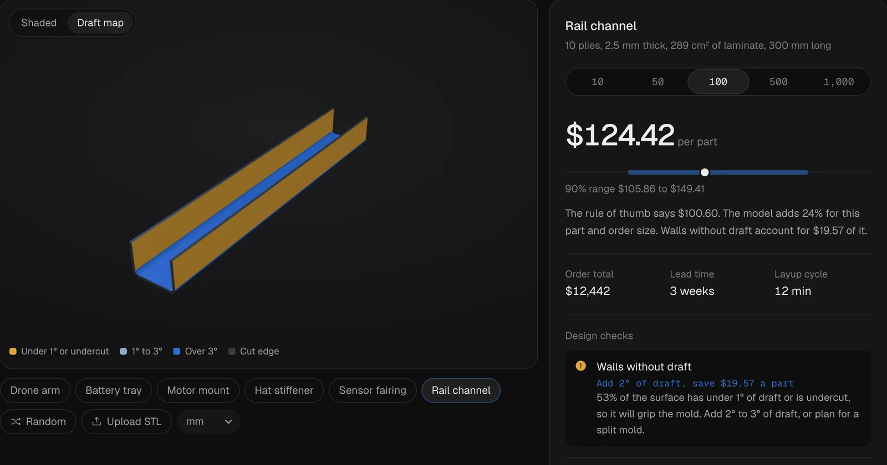

# Composite Quote Engine

Drop in a carbon-fibre part and get a price range, lead time and the design changes that would cut its cost. Live at [nabilshehadeh.org/quote](https://nabilshehadeh.org/quote/index.html).



## How it works

1. **Geometry** (`src/geometry.js`, runs in the browser and in Node). From an STL it measures laminate area and thickness, ply count, the best pull direction out of a one-sided tool, signed draft on every face (undercuts count as no draft), sharp corners between laminate surfaces, draw depth and curvature. Cut edges are told apart from laminate surfaces by patch width (2 × area / outline length).
2. **Rule of thumb** (`src/cost.js`). Prices material, layup, cure, trim, inspection and tooling from those features. Every rate is editable.
3. **Model** (`train/train.py`). LightGBM learns `log(actual / formula)`: how far a job lands from the rule of thumb. The point estimate is monotone in sharp corners, missing draft, draw depth (up) and quantity (down), so "fix this" savings are never negative. Two quantile models plus split conformal calibration (CQR) give a 90% range.
4. **Browser** (`src/model.js`). The trees run in plain JavaScript. `scripts/parity.mjs` checks them against Python's predictions.

## Results (1,600 held-out jobs)

| | Rule of thumb | Model |
| --- | --- | --- |
| Average error | 12.2% | 6.7% |
| Quotes within 10% | 63.6% | 80.1% |
| Average error, parts with design issues | 25.8% | 11.6% |
| Real cost inside the 90% range | | 88.8% |

## Honest scope

The 8,000 past jobs are simulated (`scripts/make_jobs.mjs`): a shop-floor model adds the effects a hand quote misses, such as slower layup on sharp corners and deep draws, scrap and split tools for walls without draft, learning curves on long runs and longer cures for thick laminates. The rates are illustrative, not any supplier's pricing. With real job history, the same pipeline retrains unchanged.

## Run it

Needs Node 18+ and Python 3.10+ (`pip install -r requirements.txt`). No build step or npm packages; three.js loads from a CDN.

```bash
python3 -m http.server 8000       # then open http://localhost:8000/app/
```

Rebuild the model from scratch:

```bash
node scripts/check.mjs            # geometry checks on the sample parts and 300 random parts
node scripts/make_jobs.mjs 8000   # simulate the job history -> data/jobs.csv
python3 train/train.py            # train and calibrate -> app/model.json, data/metrics.json
node scripts/parity.mjs           # the browser's tree evaluation matches Python
```

`build.mjs` copies the app into the portfolio site that hosts it, with content-hashed imports so a cached old file is never mixed with new code.
